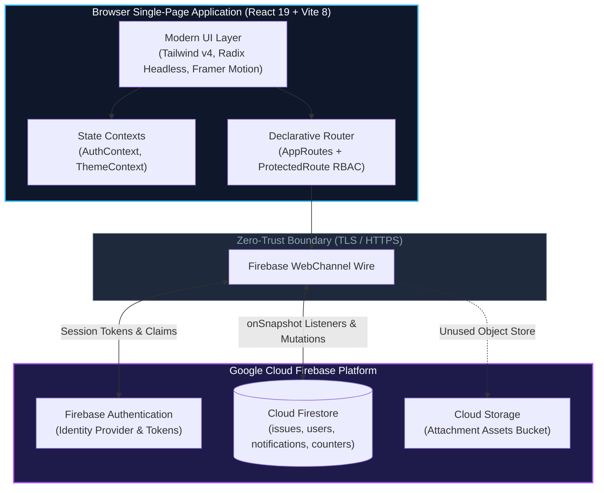
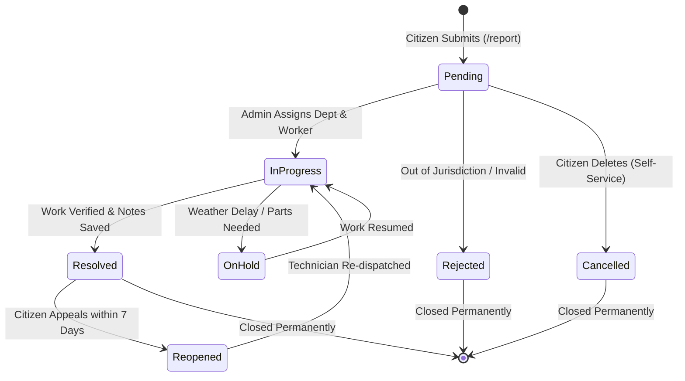

# 🏙️ Civic-Connect

**Next-Generation Civic Intelligence & Municipal Grievance Redressal**

<div align="center">


<p>
  <a href="https://civic-connect-enim.vercel.app/"></a>
  <a href="https://react.dev/"></a>
  <a href="https://vitejs.dev/"></a>
  <a href="https://tailwindcss.com/"></a>
  <a href="https://firebase.google.com/"></a>
  <a href="https://github.com/chhavikant03/Civic-Connect"></a>
</p>

</div>

<p align="center">
  <a href="#-why-civic-connect-matters">About</a> •
  <a href="#-interactive-demo--visual-tour">Visual Tour</a> •
  <a href="#-key-features">Features</a> •
  <a href="#-architecture-blueprint">Architecture</a> •
  <a href="#-live-lifecycle-state-machine">Lifecycle</a> •
  <a href="#-comprehensive-documentation-library">Documentation</a> •
  <a href="#-quickstart-guide">Setup</a> •
  <a href="#-security-audit--advisories">Security</a> •
  <a href="#-contributing">Contributing</a>
</p>

<p align="center">
  <sub>Bridging citizens and local municipalities with real-time grievance tracking, sequential ticket indexing (CMP-YYYY-XXXX), geolocation tagging, and automated administrative triage.</sub>
</p>

---

## 🌿 Why Civic-Connect Matters

> "A city works best when every resident has a voice that gets heard, and every municipal worker has the clarity to act."

A broken streetlight on a dark lane, an overflowing dumpster near a school, or a water pipeline leak — these everyday problems often go unnoticed because traditional reporting channels are fragmented, slow, and opaque.

Citizens file grievances without knowing whether anyone has received them. Municipal teams receive disorganized reports without accurate location coordinates or photo evidence.

**Civic-Connect bridges this gap with humanity, clarity, and speed.**

- **For Everyday Citizens:** Snap a photo, drop an automated GPS pin, describe what's wrong, and track your issue from dispatch to completion.
- **For Municipal Field Teams:** Triage incoming concerns, assign field crew members with direct contacts, and record resolution notes with photos.
- **For Community Advocates & Mentors:** Build trust through transparency, accountability metrics, and an active open-source ecosystem.

---

## 🎬 Interactive Demo & Visual Tour

The following diagram illustrates how a civic complaint moves through the Civic-Connect platform.

```mermaid
flowchart LR
    A["📱 Citizen Logs Issue<br/>(/report)"] -->|"Geo-Tag Coordinates & Category"| B["⚡ Cloud Firestore<br/>(Atomic Transaction CMP-2026-XXXX)"]
    B -->|"Real-Time Push Listener"| C["🏢 Municipal Admin Desk<br/>(/admin/reports)"]
    C -->|"Assign Worker & Department"| D["👷 Field Worker Dispatched<br/>(Phone + Work Order)"]
    D -->|"Log Resolution Notes"| E["✅ Ticket Resolved<br/>(Live Citizen Notification)"]

    style A fill:#0284c7,stroke:#0369a1,stroke-width:2px,color:#fff
    style B fill:#f59e0b,stroke:#d97706,stroke-width:2px,color:#fff
    style C fill:#6366f1,stroke:#4f46e5,stroke-width:2px,color:#fff
    style D fill:#8b5cf6,stroke:#7c3aed,stroke-width:2px,color:#fff
    style E fill:#10b981,stroke:#059669,stroke-width:2px,color:#fff
```



**Explore the application:** [Civic-Connect Live Demo](https://civic-connect-enim.vercel.app/)

---

## 🌟 Key Features

### 📍 Geo-Tagged Grievances

Report public infrastructure defects with browser geolocation coordinates (latitude/longitude) and human-readable landmarks.

### 🔢 Atomic Sequential IDs

Guaranteed monotonic counter transactions automatically generate civic ticket numbers formatted as `CMP-YYYY-XXXX`.

### ⚡ Instant Push Alerts

Continuous Firestore `onSnapshot` listeners power unread notification counters, navbar badges, and dynamic reactive toasts.

### 📊 Municipal Triage Desk

Multi-field filtering across 8 categories, 5 departments (Roads, Water, Sanitation, Electricity, Safety), and status indicators.

### 👷 Field Worker Dispatch

Assign field technicians with validated contact numbers (`+91 XXXXXXXXXX`) directly linked to municipal departments.

### 🌓 Modern Accessible UI

Accessible Radix UI dialogs, smooth Framer Motion layout transitions, mobile drawer navigation, and dark/light mode toggle.

---

## 🏗️ Architecture Blueprint

Civic-Connect follows a client-direct Backend-as-a-Service (BaaS) architecture.



---

## 🔄 Live Lifecycle State Machine

Complaints advance through an accountable state machine:



---

## 📖 Comprehensive Documentation Library

The project's technical documentation is organized into **5 master manuals** inside the [`docs/`](docs/) directory.

New to the project? Start with the Documentation Hub, then explore the other manuals whenever you need more technical details.

| Manual | Target Audience | Primary Coverage |
|---|---|---|
| [Manual 1: Documentation Hub](docs/documentation-hub.md) | Newcomers & Evaluators | Mission, problem statement, citizen/admin responsibilities, terminology glossary, reading matrix |
| [Manual 2: Architecture & Data](docs/architecture-and-data.md) | Architects & Engineers | BaaS trust boundaries, sequence diagrams with failure paths, complete Firestore schemas, indexes, ADRs |
| [Manual 3: Features & Workflows](docs/features-and-workflows.md) | Product Teams & QA | 20+ feature status audit, complaint state machine, worker dispatch journeys, UI/UX and accessibility |
| [Manual 4: Security & Quality](docs/security-quality-and-issues.md) | Security Reviewers & QA | Threat model, production Firestore rules, confirmed defects register (CC-001..011), test cases |
| [Manual 5: Operations & Roadmap](docs/operations-and-roadmap.md) | Maintainers & Contributors | Local development, Firebase emulators, SPA rewrites, cloud budget controls, phased roadmap, PR rules |

### Documentation Structure

```text
docs/
├── documentation-hub.md
├── architecture-and-data.md
├── features-and-workflows.md
├── security-quality-and-issues.md
└── operations-and-roadmap.md
```

---

## 🚀 Quickstart Guide

Want to explore the project, understand the codebase, or make your first contribution?

Let's get Civic-Connect running locally!

### Prerequisites

Before starting, make sure you have:

| Requirement | Version |
|---|---|
| Node.js | v18.0.0 or higher |
| npm | v9 or higher |
| Git | v2.30 or higher |

**Check your installed versions:**

```bash
node -v
npm -v
git --version
```

If any of these commands are not recognized, install the missing software before continuing.

- [Download Node.js](https://nodejs.org/)
- [Install Git](https://git-scm.com/)

### Step 1: Fork the Repository

If you want to contribute, first create your own copy of the repository.

1. Visit the [Civic-Connect GitHub repository](https://github.com/chhavikant03/Civic-Connect).
2. Click the **Fork** button in the top-right corner.
3. Your fork will appear under your GitHub account.

> Why fork? A fork allows you to make changes independently without directly modifying the original repository.

### Step 2: Clone Your Fork

Open your terminal (Git Bash, VS Code terminal, or Command Prompt).

Run:

```bash
git clone https://github.com/YOUR-USERNAME/Civic-Connect.git
```

Replace `YOUR-USERNAME` with your actual GitHub username.

Move into the project directory:

```bash
cd Civic-Connect
```

### Step 3: Install Dependencies

Install all the packages required by the project:

```bash
npm install
```

This command reads the project's `package.json` and installs the required dependencies.

Wait for the installation to finish before moving to the next step.

### Step 4: Configure Environment Variables

Create your local environment file:

```bash
cp .env.example .env
```

Open `.env` in your code editor and configure the required Firebase environment variables.
**For Dev Sandbox Firebase keys , refer to the Discussions tab of this repository , you will find required API Keys there.**

**Important:**
- Make sure you have the required Firebase configuration.
- Never share private credentials.
- Never commit your `.env` file to GitHub.

If you need help with the Firebase configuration, refer to the project's documentation or ask the maintainers.

### Step 5: Start the Development Server

Run:

```bash
npm run dev
```

Vite will start the local development server.

Open the URL displayed in your terminal, usually:

```text
http://localhost:5173
```

🎉 Congratulations! Civic-Connect is now running on your machine.

### Useful Commands

| Command | Purpose |
|---|---|
| `npm install` | Install project dependencies |
| `npm run dev` | Start the development server |
| `npm run lint` | Check code using the project's linter |
| `npm run build` | Build the application for production |

### Having Trouble?

Here are a few things to check:

- **`node` or `npm` not recognized:** Check your Node.js installation and PATH.
- **Dependency installation failed:** Check your internet connection and try `npm install` again.
- **Environment configuration error:** Verify your `.env` file and Firebase configuration.
- **Port already in use:** Check whether another development server is running.
- **Application not starting:** Check the terminal output for errors.

Still stuck? Feel free to ask for help in the project's [GitHub Issues](https://github.com/chhavikant03/Civic-Connect/issues).

---

## 🛡️ Security Audit & Advisories

An independent architectural review established a security register covering identified security and quality concerns.

The following findings are highlighted:

| ID | Severity | Finding Summary | Impact | Action Required |
|---|---|---|---|---|
| CC-001 | `Critical` | Hardcoded admin credentials embedded in `AuthPage.jsx` | Administrative account takeover | Remove hardcoded email/password |
| CC-002 | `Critical` | User registration accepts caller-supplied `role` string | Self-elevation to administrator | Enforce roles via Custom Claims |
| CC-003 | `High` | Missing version-controlled `firestore.rules` in repository | Database access unverified in Git | Commit rules to project root |
| CC-004 | `High` | Issue created before notification failure triggers error toast | Duplicate ticket submission | Wrap operations in `writeBatch` |
| CC-005 | `High` | Live snapshot listener overwrites unsaved resolution notes | Loss of uncommitted draft notes | Guard textarea with dirty-state check |

For complete remediation blueprints, additional findings (CC-001 to CC-011), and test cases, read [Manual 4: Security & Quality](docs/security-quality-and-issues.md).

---

## 👥 Project Leadership & Mentorship

| Leadership Role | Name | Affiliation & Connect |
|---|---|---|
| Project Mentor | **Kartik Chilkoti** | [WOCS 2026](https://github.com/chhavikant03/Civic-Connect) |
| Project Admin & Creator | **Chhavi Kant** | [GitHub](https://github.com/chhavikant03) · [LinkedIn](https://www.linkedin.com/in/chhavi-kant-959bb1306/) |

---

## 🤝 Contributing

We welcome contributions from participants of **Winter of Code Social (WOCS) 2026** and the global developer community!

Whether you're an experienced developer or making your first open-source contribution, you're welcome here.

You don't need to understand the entire codebase before getting started. Take your time, explore the project, and ask questions whenever you need help.

### Before You Start

1. Explore the project and understand what it does.
2. Read the [Documentation Hub](docs/documentation-hub.md).
3. Check the existing [GitHub Issues](https://github.com/chhavikant03/Civic-Connect/issues).
4. Find an issue that matches your interests and skill level.

### Your First Contribution: Step by Step

#### 1. Find an Issue

Visit the [Issues section](https://github.com/chhavikant03/Civic-Connect/issues) and look for an issue you'd like to work on.

Read the issue description carefully to understand the expected changes.

#### 2. Get Assigned

Before writing any code:

- Comment on the issue expressing your interest.
- Wait for official maintainer assignment.
- Don't start working on an issue already assigned to someone else.

#### 3. Fork and Clone

Fork the repository and clone your fork:

```bash
git clone https://github.com/YOUR-USERNAME/Civic-Connect.git
cd Civic-Connect
```

Add the original repository as an upstream remote:

```bash
git remote add upstream https://github.com/chhavikant03/Civic-Connect.git
```

#### 4. Create a Branch

Create a separate branch for your work:

For new features:

```bash
git checkout -b feature/your-feature-name
```

For bug fixes:

```bash
git checkout -b fix/your-fix-name
```

#### 5. Make Your Changes

- Follow the existing project structure and coding style.
- Keep your changes focused on the assigned issue.
- Avoid unnecessary modifications to unrelated files.
- Test your changes locally.
- Run the linter:

```bash
npm run lint
```

#### 6. Commit Your Changes

Use clear and meaningful commit messages following Conventional Commits.

Examples:

```bash
git add .
git commit -m "feat: add issue filtering"
```

```bash
git commit -m "fix: resolve navbar responsiveness"
```

```bash
git commit -m "docs: improve setup instructions"
```

#### 7. Push Your Branch

Push your branch to your fork:

```bash
git push origin feature/your-feature-name
```

Replace the branch name with your actual branch name.

#### 8. Open a Pull Request

Once your changes are pushed:

1. Visit your fork on GitHub.
2. Click **Compare & pull request**.
3. Select `chhavikant03/Civic-Connect` as the base repository.
4. Select `main` as the base branch.
5. Provide a clear PR title and description.
6. Link the issue you're working on.
7. Include screenshots and test evidence when applicable.

Submit your Pull Request and wait for the maintainers to review it.

If changes are requested, make the necessary updates and push them to the same branch.

**That's it! You've made your contribution to Civic-Connect.** 🎉

### Contribution Standards

Please follow these guidelines when contributing:

- Get assigned to an issue before starting work.
- Use meaningful branch names (`feature/*`, `fix/*`).
- Follow Conventional Commits (`feat:`, `fix:`, `docs:`).
- Run `npm run lint` before submitting.
- Keep Pull Requests focused and easy to review.
- Include screenshots and test evidence where relevant.
- Be respectful and collaborative during discussions and reviews.

For complete contribution rules, Firebase emulators, deployment instructions, and roadmap details, see [Manual 5: Operations & Roadmap](docs/operations-and-roadmap.md).

---

<div align="center">


⭐ **If you find Civic-Connect inspiring, consider giving this repository a star!** ⭐

*Together, let's build cleaner, safer, and more connected communities.* 🏙️

</div>
